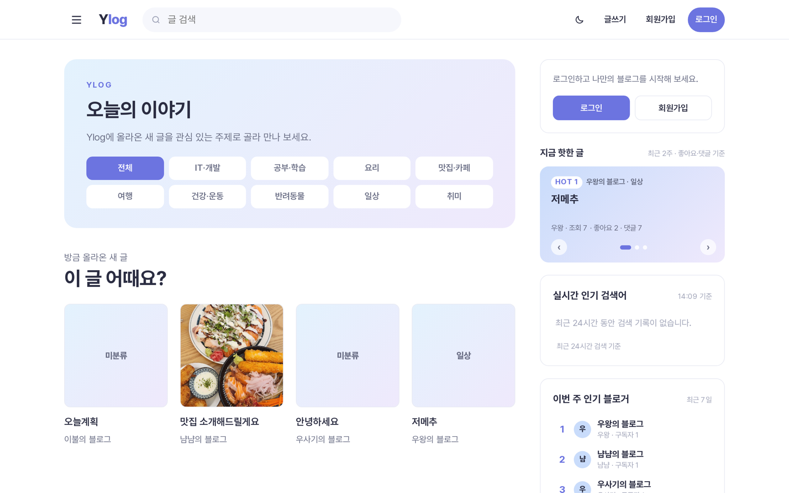
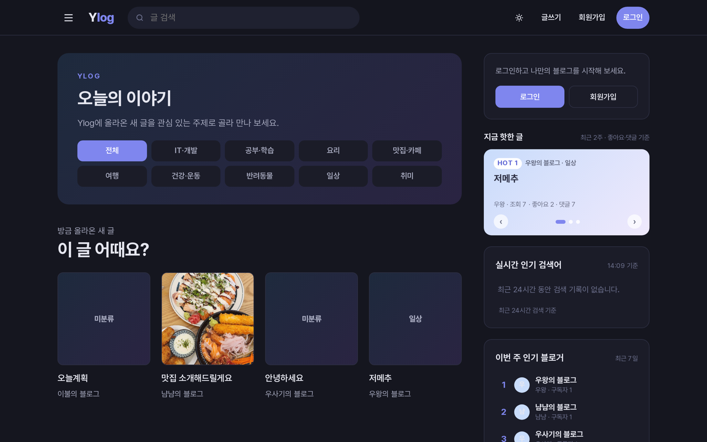

# Ylog

누구나 블로그를 만들어 글을 쓰고 나누는 서비스

**[ylog.java21.net](https://ylog.java21.net)**

  
  

## 프로젝트 개요

**Ylog**는 회원가입만 하면 자기 블로그를 하나 갖고, 글을 쓰고, 다른 사람의 글을 주제별로 둘러보며 댓글과 좋아요로 소통하는 블로그 서비스입니다. 기획부터 배포·운영까지 혼자 진행했습니다.

| 항목 | 내용 |
|---|---|
| 기간 | 2026-10-08 ~ 진행 중 (요구사항 작성 당일 첫 배포) |
| 배포 주소 | https://ylog.java21.net |
| 현재 버전 | v1.11.1 · [릴리스 기록](https://github.com/my-blog-home/blog-app/releases) |

## 저장소

| 저장소 | 내용 |
|---|---|
| [**blog-app**](https://github.com/my-blog-home/blog-app) | 서버(Spring Boot)·화면(React) 코드와 배포 스크립트. 설계 결정·트러블슈팅·성능 측정은 [README](https://github.com/my-blog-home/blog-app#readme)에 |
| [**docs**](https://github.com/my-blog-home/docs) | 코드보다 먼저 쓴 요구사항과 설계 문서 (GitHub Spec Kit) |
| [**.github**](https://github.com/my-blog-home/.github) | 이 소개 페이지 |

## 주요 기능

- **가입·로그인**: 이메일 인증번호(Gmail 발송), GitHub·카카오 소셜 로그인, 로그인 5회 실패 시 10분 잠금
- **글쓰기**: 마크다운과 툴바, 이미지 붙여넣기, 임시저장, 공개 범위, 분류·태그·주제
- **둘러보기**: 주제별·인기순, 목록형·피드형, 지금 핫한 글, 실시간 인기 검색어, 인기 블로거, 다크 모드
- **소통과 운영**: 댓글·답글·비밀 댓글, 좋아요·북마크·구독, 방문 통계, 관리자(신고·정지·공지)

## 이런 점에 신경 썼습니다

| 무엇 | 어떻게 | 결과 |
|---|---|---|
| 빠른 첫 화면 | 실시간 인기 검색어를 Redis에 캐싱, 핫한 글·인기 블로거는 실행 계획으로 병목(색인을 못 쓰는 날짜 조건)을 찾아 고친 뒤 캐싱 | 처리량 약 **370배**, **25~33배** |
| 멈추지 않는 배포 | Nginx 뒤에서 새 버전을 옆에 띄워 확인한 뒤 넘기는 블루-그린 배포 | 배포 중 멈춤 7.5초 → **0초** |
| 앱 2개로 나눠 받기 | Nginx가 앱 2개에 번갈아 보내고, 로그인 세션은 DB에 둬서 어느 앱으로 가도 유지 | 200번 요청 **100 / 100**, 배포 중 1,198번 요청 **실패 0번** |
| 쉬운 가입 | GitHub·카카오 OAuth2 로그인, 이메일 인증번호는 Gmail로 실제 발송 | 비밀번호 없이도 가입 |

## 이렇게 만들었습니다

- **문서 먼저**: Spec Kit으로 원칙 → 요구사항 → 기술 결정 → 설계 → 할 일 순서로 정한 뒤 개발했습니다.
- **Git Flow**: `feature/*` → `develop`, 내보낼 때만 `release/x.y.z` → `main`으로 버전을 올립니다.
- **CI/CD**: PR마다 테스트(실제 PostgreSQL·Redis)와 도커 빌드, `main`에 병합되면 배포와 업데이트 공지·GitHub 릴리스까지 자동입니다.
